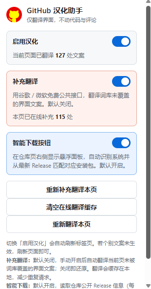
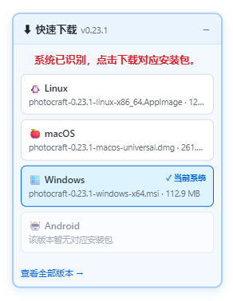

# GitHub 汉化助手

一款 Chrome Manifest V3 扩展，把 GitHub 界面翻译成中文，同时提供按系统匹配 Releases 安装包的悬浮下载面板。

**只翻译界面，不动代码与用户内容。** 代码、提交 diff、README/评论正文、表单值、用户昵称等一律保持原文；仅在开启「补充翻译」时，才按需翻译词库未覆盖的界面文案与文档正文。

---

## 效果预览

**插件弹窗** —— 三个开关一目了然，实时显示当前页面已翻译 / 在线补充的文案条数：



**仓库页悬浮下载面板** —— 自动识别当前系统（图中 Windows）并高亮，按平台匹配最新 Release 的安装包：



---

## 功能特性

### 1. 界面汉化（默认开启）
- 内置 **2083 条界面词条**、**80 条动态规则**、**78 条属性文案**（placeholder / aria-label / title），覆盖导航栏、设置页、仓库页、Issues、Pull Requests、讨论区、通知、搜索结果等常见界面。
- 只翻译界面文案，跳过 `<code>` / `<pre>` / 代码高亮区、Markdown 正文、可编辑区域与表单值。
- 动态规则处理含用户名、相对时间、数量、邮箱等变量的句子（如 `Updated 3 days ago`、`N users starred this repository`）。
- 自动弯引号 / 空白归一化，兼容 GitHub 新旧 DOM 结构与文案差异。
- 监听页面动态渲染和站内单页导航，新出现的界面元素会自动翻译。
- 关闭开关时把页面还原成英文。

### 2. 补充翻译（默认关闭）
- 用谷歌 / 微软免费公共翻译接口，翻译词库未覆盖的界面英文；微软优先，失败自动降级谷歌。
- 可放行 README 文档正文、Issues 标题与帖子/回复正文（含新版 React 评论结构），代码块仍跳过。
- 结果缓存在本地，同一句不重复请求；点「清空在线翻译缓存」可重置。
- 邮箱、链接、@用户名、提交哈希、纯数字等会自动跳过，避免误译。
- 扩展重载后旧页面会提示「请刷新本页」，不会产生未捕获异常。

### 3. 智能下载按钮（默认开启）
- 在仓库页右侧显示悬浮面板，自动识别当前系统与 CPU 架构（Windows / macOS / Linux / Android）。
- 读取仓库最新 Release 的资源列表，按平台关键字、架构、文件格式打分匹配，选中最优安装包，点击即下载。
- 排除 `.asc` / `.sig` / `SHA256SUMS` 等辅助文件与 CLI/Web 包，避免误选。
- Release 信息缓存 10 分钟；网络失败时回退旧缓存。仅调用公开 GitHub API，不修改页面原有内容。
- 可在弹窗里关闭该按钮。

### 4. 自定义图标
- 工具栏图标跟随汉化开关：开启显示红色 LOGO，关闭显示黑色 ICON。
- 汉化开启时，GitHub 左上角 logo 同步替换为自定义 SVG（红色圆底 + 黄色 GitHub 猫）；关闭时自动还原。

---

## 安装

### 方式一：CRX 安装包（推荐）
1. 打开 `chrome://extensions`，右上角开启「开发者模式」。
2. 把 `dist/GitHub汉化助手.crx` 拖进该页面，按提示添加扩展。

### 方式二：加载已解压的扩展
1. 解压 `dist/GitHub汉化助手.zip` 到任意目录。
2. 打开 `chrome://extensions` → 开启「开发者模式」→ 点「加载已解压的扩展程序」，选择解压后的目录。

> 新版 Chrome 对本地 CRX 有安全限制，若拖拽安装被拦截，请用方式二。

---

## 使用

点击浏览器工具栏的插件图标打开弹窗：

| 开关 / 按钮 | 说明 |
|---|---|
| **启用汉化** | 总开关，开启才翻译界面并替换左上角 logo；切换后会自动刷新标签页 |
| **补充翻译** | 按需翻译词库未覆盖的文案，默认关闭，可随时开关 |
| **智能下载按钮** | 控制仓库页右侧的悬浮下载面板，默认开启 |
| 重新翻译本页 | 重新执行词库层翻译 |
| 重新补充翻译本页 | 丢弃上一轮在线译文，重新扫描翻译 |
| 清空在线翻译缓存 | 清除本地缓存的在线译文 |

---

## 项目结构

```
Github-chinese-extension/
├── manifest.json          # 扩展清单（MV3）
├── background.js          # service worker：图标切换、在线翻译、Release API 与缓存
├── translations.js        # 词库：界面词条 / 动态规则 / 属性文案
├── content.js             # 内容脚本：DOM 翻译、补充翻译、左上角 logo 替换
├── release-downloader.js  # 仓库页悬浮下载面板
├── popup.html / popup.js  # 弹窗界面与交互
├── icons/                 # 图标素材（黑色 ICON / 红色 LOGO，各 16/48/128）
└── dist/                  # 打包产物
    ├── GitHub汉化助手.crx
    ├── GitHub汉化助手.zip
    └── GitHub汉化助手.pem  # 签名私钥，更新时复用以保持扩展 ID
```

---

## 打包更新

修改代码后重新打包，务必带上私钥以保持扩展 ID 不变（否则更新会被当作新扩展，丢失设置）：

```bash
chrome.exe --pack-extension=<扩展目录的Windows路径> --pack-extension-key=<pem文件路径>
```

当前扩展 ID：`ifomojpncemjfkjbabdecpjedcappcpp`

> 私钥已加入 `.gitignore`，请勿提交或删除。若不慎丢失，重新打包会得到新的扩展 ID，更新时需先卸载旧版，设置与缓存会重置。

---

## 权限说明

| 权限 | 用途 |
|---|---|
| `storage` | 保存开关状态与本地翻译 / Release 缓存 |
| `activeTab` | 读取当前标签页以执行翻译 |
| `github.com` / `gist.github.com` | 注入内容脚本的站点 |
| `api.github.com` | 读取仓库最新 Release 资源列表 |
| `edge.microsoft.com` / `translate.googleapis.com` | 补充翻译的免费公共接口 |

扩展不会上传你的 GitHub 账号数据、代码或私人内容；补充翻译只把界面文案片段发给翻译接口。

---

## 已知限制

- GitHub API 未认证访问限制为每小时 60 次，已用 10 分钟缓存缓解；超出限额时下载面板会回退到旧缓存。
- 补充翻译依赖第三方公共接口，接口不可用时自动回退，界面仍由内置词库兜底。
- 若个别文案未生效，刷新页面或点「重新翻译本页」即可。
